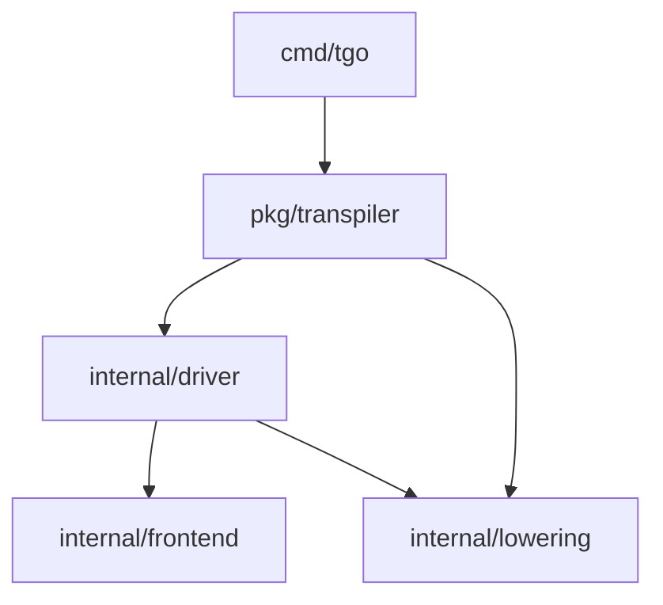

# Transpiler architecture

The transpiler lowers postfix error propagation and supports statement insertion
after a typed Go expression. See [transpiler use and API](../transpiler.md) for
commands and public operations, and the
[expression-lowering plan](../adr/expression-lowering/what.md) for its semantics.

`Load(directory, pattern)` loads one package with Go syntax and type information.
`Source.Sites` lists every expression by file, byte offsets, and syntax kind.
`Reason` identifies syntax without a current-function evaluation. `ErrorReturn`
identifies functions with one `error` result; `ReturnReason` records other
return signatures. Function literals have their own return target.

`InsertAfter(site, callback)` returns formatted files keyed by absolute path.
It keeps the input AST unchanged. The callback receives references to the
expression's results, including tuple results. An assignment destination has
no value result. The callback must supply valid Go statements for that scope.

For an expression in a function with an `err` binding and one `error` result:

```go
files, err := source.InsertAfter(site, func(results []ast.Expr) []ast.Stmt {
    return []ast.Stmt{
        &ast.ReturnStmt{Results: []ast.Expr{ast.NewIdent("err")}},
    }
})
```

The insertion runs after evaluation and before the surrounding operation uses
the result. It is skipped when the expression is skipped. For example, insertion
after `right()` in `use(left(), right())` produces this order:

```go
leftValue := left()
rightValue := right()
return err
use(leftValue, rightValue)
```

The final call remains in the output so source bindings and label targets remain
valid. It cannot execute after the return. Earlier effects remain; later work
is skipped. Normal deferred calls still run.

## Packages and dependencies



| Package | Responsibility |
| --- | --- |
| `pkg/transpiler` | Public `Compile`, `Load`, `Source`, `Site`, and `After` API |
| `cmd/tgo` | CLI arguments and output files |
| `internal/driver` | Module files, Go build selection, type checking, and compilation order |
| `internal/frontend` | Postfix operators and marker calls for the Go type checker |
| `internal/lowering` | Typed expression inventory, statement insertion, and Go AST emission |

The frontend and lowering packages have no dependency on each other or the
driver. The driver converts frontend marker records to lowering operations
after type checking. The lowering package receives typed Go syntax and the
error action for each marker call; it does not read TGo tokens or module files.

Integration tests and the proof corpus are in `tests/`. They use the
public API and check the complete compilation path. The expression unit test
lives with the lowering implementation. No test depends on driver internals.
Propagation cases use fixture directories
and compare generated output with committed snapshots before execution. See the
[integration test guide](../../tests/README.md).

# Verification

```sh
go test ./tests -run '^TestProof' -count=1
```

The manifest records expression sites, including excluded syntax and incompatible
return signatures. `TestProofCompile` compiles neutral and return variants.
`TestProofNeutral` runs marker variants against handwritten effect and value
traces and insertion positions across the corpus. `TestProofReturn` checks
first and second visits, early exits, deferred calls, closure return boundaries,
and the identity of the returned error.

Focused execution tests also cover assignments, short circuits, closures,
loops, switches, ranges, selects, defers, jumps, tuples, Boolean conversions,
array storage, and pointer receivers. Hosted CI runs the full test suite.

# Propagation frontend

The frontend reads `.tgo` files in a Go module. Use this command to emit a Go
module into another directory:

```sh
go run ./cmd/tgo -o /tmp/generated /path/to/source
go -C /tmp/generated build ./...
```

`call()!!` returns the same non-nil error from the current function.
`call()!` adds the source call name with `%w` once. Both operators remove the
call's final error result from its success values. Earlier effects remain;
later work stops on failure. Other function results are zero on this return.
Normal deferred calls run.

The scanner marks suffixes. The Go parser supplies the syntax tree. The Go
type checker resolves each call. Generated generic functions let the checker
see each call without its error result. The existing lowering engine then
saves the call results, checks the error, and emits the return at that point.
It lowers all marked calls in one pass over the typed source AST.

Generated result variables supply typed zero values. This keeps private and
generic result types and avoids type names that local bindings can hide.
Source named results keep their bindings and values on success.

For generic indexed variables, keep array storage and save slice or map headers.
If the type set permits both, a generated type test selects the storage form.
Type aliases at the start of the function keep type parameters available when
local variables hide their source names.

A literal with an omitted type keeps the type of its original container. This
lets Go infer private element types. Map key operands are saved without moving
the map's key checks before later source work.

The Boolean lowerer uses a constant-false expression to infer the result type
without executing the source expression. A generic function can remain in that
expression for type checking. Its call cannot run. Other unused generated
functions are removed.

The module loader uses Go's build selection, including test packages. Files
outside that selection keep their `.tgo` source. Relative module replacements
keep their original dependency paths in the emitted module.

Focused propagation checks:

```sh
go test ./tests -run '^TestPropagation' -count=1
```

Literal tests cover nested omitted types, map values, pointer keys, and array
keys. A key with an unhashable interface field fails when the map is built,
after its value expression runs. The engine infers the key type from an empty
map and assigns its fields or elements to a fresh value.

For an array element read, the engine saves the location's operands and runs
the index expression before the element access can panic. An explicit address
operation completes its address checks before insertion after that operation.

A type parameter can accept both arrays and slices. For arrays, the generated
code uses the original storage. For slices, it saves the slice value, which
contains a data pointer, length, and capacity. It selects this behavior from
the instantiated type, without reading array elements. A fresh type alias keeps
the parameter available if a source local has the same name. RHS results are
saved before stores, including every result of a tuple call.
